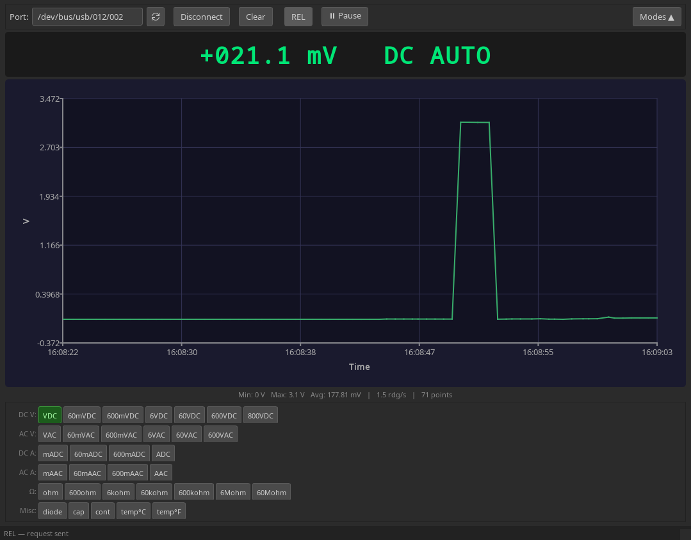
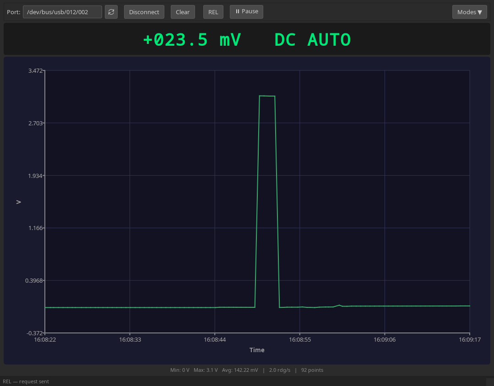

# Hantek 365C/D/E/F — Linux Tools

Open-source Linux tools for the **Hantek 365C**, **Hantek 365D**, **Hantek 365E** and **Hantek 365F** true-RMS multimeters.

The meter connects either through its radio USB dongle or directly with a USB cable — no proprietary drivers needed:
- radio dongle: standard CDC-ACM serial port, `0451:16aa` Texas Instruments, Inc. TI CC2540 USB CDC
- USB cable: vendor-specific bulk interface, `0483:5722` Hantek DMM USB, accessed through Linux usbdevfs

Two independent tools are provided:

| Tool | Language | Description |
|------|----------|-------------|
| `hantek365.pl` | Perl | Command-line reader with CSV/timestamp output |
| `hantek365_gui/` | C++ / Qt 6 | Desktop GUI with real-time chart and mode switching |

---

## Download

The GUI is published as an AppImage on the [Releases page](https://github.com/ashevchuk/hantek-365/releases/latest).
It bundles Qt and runs on any x86_64 Linux distribution with glibc 2.28 or newer
(Debian 10+, Ubuntu 18.10+, RHEL/Alma/Rocky 8+, Fedora 29+, current Arch):

```bash
chmod +x Hantek_365F-x86_64.AppImage
./Hantek_365F-x86_64.AppImage
```

Every push and pull request also builds the AppImage; it is attached as an artifact
to the corresponding [Actions run](https://github.com/ashevchuk/hantek-365/actions).

The Perl tool needs no build — run `hantek365.pl` directly.

---

## Table of Contents

- [Download](#download)
- [Screenshots](#screenshots)
- [Hardware](#hardware)
- [Protocol Overview](#protocol-overview)
- [Perl CLI Tool](#perl-cli-tool)
  - [Requirements](#requirements-perl)
  - [Usage](#usage)
  - [Examples](#examples)
  - [Output Formats](#output-formats)
- [Qt GUI Application](#qt-gui-application)
  - [Requirements](#requirements-qt)
  - [Building](#building)
  - [Building the AppImage](#building-the-appimage)
  - [Running](#running)
  - [Interface](#interface)
  - [Responsive Layout](#responsive-layout)
- [Packet Format Reference](#packet-format-reference)
  - [Commands](#commands)
  - [Measurement Packet](#measurement-packet)
  - [Mode Codes](#mode-codes)
- [Permissions](#permissions)
- [Project Structure](#project-structure)
- [License](#license)

---

## Screenshots

### GUI — Full View



*Real-time voltage chart with mode buttons, toolbar, and statistics bar.*

### GUI — Compact Mode (toolbar and chart only)



*Window resized below 400 px height: mode panel automatically hide.*

### GUI — Minimal Mode (value only)


*Window resized below 140 px height: only the current measurement remains — useful as a small floating widget.*

### CLI Tool

```
./hantek365.pl -u -m VDC -t

Setting mode: VDC (0xa0)
Mode set.
Reading measurements. Press Ctrl+C to stop.
2026-10-15 15:08:52.500 | +016.9 mV  DC AUTO
2026-10-15 15:08:53.102 | +016.9 mV  DC AUTO
2026-10-15 15:08:53.503 | +016.9 mV  DC AUTO
```

*Perl script reading DC voltage with timestamps.*

---

## Hardware

| Property | Value |
|----------|-------|
| Supported models | Hantek 365C, Hantek 365D, Hantek 365E, Hantek 365F |
| Radio dongle | Texas Instruments, Inc. TI CC2540 USB CDC (virtual serial port), `0451:16aa` |
| Radio dongle device node | `/dev/ttyACM0` (or `ttyACM1`, …) |
| USB cable | Hantek DMM USB, vendor-specific class, bulk endpoints `0x81` IN / `0x02` OUT, `0483:5722` |
| USB cable device node | `/dev/bus/usb/BBB/DDD` (bus and device number, see `lsusb`) |

The dongle needs no special kernel drivers — the standard `cdc_acm` module handles it.
The USB cable has no kernel driver at all; both tools talk to it through usbdevfs ioctls
and need the udev rule described in [Permissions](#permissions).

Both connections carry the same protocol.

---

## Protocol Overview

Communication uses a simple binary protocol, identical over the dongle's serial port
and the USB cable's bulk endpoints.

### Request/Response cycle

```
Host → Device: [0x01, 0x0F]        poll for current reading
Device → Host: [0xAA]              no data available yet
Device → Host: [0xA0, …×14]       15-byte measurement packet
```

Polling is done every **200 ms**. A response is expected within one poll interval; if it is not received the host resets and retries automatically.

### Mode change

```
Host → Device: [0x03, MODE_BYTE]   set mode / sub-range step
Device → Host: [0xDD]              acknowledgement
```

For modes in the range `0xA0–0xE6` the host must **cycle through sub-ranges** starting from 0 up to the target nibble, waiting for `0xDD` after each step (50 ms between steps). Special modes `0xF0–0xF6` (diode, cap, continuity, temperature) are sent directly without cycling.

---

## Perl CLI Tool

### Requirements (Perl)

- Perl 5.10 or newer (standard on all Linux distributions)
- Modules used — all are part of Perl core: `POSIX`, `Fcntl`, `Getopt::Long`, `Time::HiRes`
- No CPAN modules required

### Usage

```
./hantek365.pl [options]

Options:
  -p, --port PORT       Serial port of the radio dongle (default: /dev/ttyACM0),
                        or a USB device node /dev/bus/usb/BBB/DDD
  -u, --usb             Direct USB cable: find the meter automatically
  -m, --mode MODE       Set measurement mode before reading
  -r, --relative        Enable relative (REL) measurement
  -v, --verbose         Print raw packet bytes for debugging
  -t, --timestamp       Prefix each reading with YYYY-MM-DD HH:MM:SS.mmm
  -c, --csv             CSV output: timestamp,value,prefix,unit,flags
  -i, --interval MS     Minimum interval between readings in ms (0 = max speed)
  -g, --tui             TUI graph mode: scrolling bar chart in the terminal
  -h, --help            Show help and exit
```

**Available modes** (case-insensitive):

| Category | Mode names |
|----------|-----------|
| DC Voltage | `VDC` `60mVDC` `600mVDC` `6VDC` `60VDC` `600VDC` `800VDC` |
| AC Voltage | `VAC` `60mVAC` `600mVAC` `6VAC` `60VAC` `600VAC` |
| DC Current | `mADC` `60mADC` `600mADC` `ADC` |
| AC Current | `mAAC` `60mAAC` `600mAAC` `AAC` |
| Resistance | `ohm` `600ohm` `6kohm` `60kohm` `600kohm` `6Mohm` `60Mohm` |
| Special | `diode` `cap` `cont` `temp` `tempc` `tempf` |

If `-m` is omitted the script reads whatever mode the multimeter is already in.

### Examples

```bash
# DC voltage with timestamp
./hantek365.pl -m VDC -t

# Resistance to CSV file
./hantek365.pl -m ohm -c > resistance.csv

# Temperature (°C) once per second
./hantek365.pl -m temp --interval 1000

# DC voltage over the direct USB cable
./hantek365.pl -u -m VDC -t

# AC voltage on a different port, with raw debug output
./hantek365.pl -p /dev/ttyACM1 -m VAC -v

# REL mode — all readings relative to the first
./hantek365.pl -m VDC -r -t

# DC voltage as a scrolling bar chart in the terminal
./hantek365.pl -m VDC --tui

# Pipe into gnuplot or awk
./hantek365.pl -m VDC -c | awk -F, '{print $1, $2}'
```

### Output Formats

**Default** (human-readable):

```
+017.5 mV  DC AUTO
+017.6 mV  DC AUTO
```

**With timestamp** (`-t`):

```
2026-10-15 15:08:52.500 | +016.9 mV  DC AUTO
2026-10-15 15:08:53.102 | +016.9 mV  DC AUTO
```

**CSV** (`-c`, timestamps always include milliseconds):

```
timestamp,value,prefix,unit,flags
2026-10-15 15:08:54.744,+017.1,m,V,DC AUTO
2026-10-15 15:08:55.345,+017.2,m,V,DC AUTO
```

The `value` column is the displayed number as sent by the meter: sign and leading zeros included, SI prefix still applied (e.g. `+017.1` with prefix `m` = 17.1 mV). Multiply by the appropriate factor to obtain SI base units.

On overload the meter sends `?` and `:` instead of digits (e.g. `+?0:.?`). The default, `-t` and CSV outputs pass this through unchanged, so a CSV consumer must treat a non-numeric `value` as overload; the TUI shows `OL`.

---

## Qt GUI Application

### Requirements (Qt)

| Dependency | Version |
|-----------|---------|
| CMake | ≥ 3.16 |
| C++ compiler | C++17 (GCC 9+ / Clang 10+) |
| Qt | 6.x |
| Qt modules | `Widgets`, `SerialPort`, `Charts` |

On Arch Linux:

```bash
sudo pacman -S qt6-base qt6-charts qt6-serialport cmake
```

On Ubuntu 24.04 / Debian 13:

```bash
sudo apt install qt6-base-dev qt6-charts-dev qt6-serialport-dev cmake
```

On Fedora:

```bash
sudo dnf install qt6-qtbase-devel qt6-qtcharts-devel qt6-qtserialport-devel cmake
```

### Building

```bash
cd hantek365_gui
cmake -B build -DCMAKE_BUILD_TYPE=Release
cmake --build build -j$(nproc)
```

The resulting binary is `hantek365_gui/build/hantek365_gui`. It links against the
system Qt; for a self-contained build use the AppImage.

### Building the AppImage

The release AppImage is built by `ci/build-appimage.sh` inside an AlmaLinux 8 container,
which fixes the glibc baseline at 2.28. The same script runs in GitHub Actions and locally
(Docker or Podman, from the repository root):

```bash
docker run --rm -v "$PWD":/src -w /src almalinux:8.10 ci/build-appimage.sh
```

The script installs the official Qt 6.8 with `aqtinstall`, builds the GUI and packages it
with `linuxdeploy` + `linuxdeploy-plugin-qt`. The result is `dist/Hantek_365F-x86_64.AppImage`.

### Running

```bash
./build/hantek365_gui                 # from hantek365_gui/ after building
./Hantek_365F-x86_64.AppImage         # downloaded or built AppImage
```

Publishing a release: push a tag `v*` (e.g. `git tag v1.1 && git push origin v1.1`);
the workflow attaches the AppImage to a new GitHub Release.

### Interface

```
┌───────────────────────────────────────────────────────────────────────────┐
│ Port: [/dev/ttyACM0 ] [o] [Connect]  [Clear]  [REL] [|| Pause]  [Modes ^] │  ← Toolbar
├───────────────────────────────────────────────────────────────────────────┤
│                                                                           │
│                    +1.2345 mV   DC AUTO                                   │  ← Value display
│                                                                           │
├───────────────────────────────────────────────────────────────────────────┤
│   ^                                                                       │
│   │                                              /~~~~~~~~\        /~~    │
│   │  / ~~~~~~~~~~~~~~~~~~~\                     /          \      /       │
│   │ /                      \                   /            ~~~~~~        │  ← Real-time chart
│   │/                        ~~~~~~~~~~~~~~~~~~~                           │
│   └────────────────────────────────────────────────────────────────── >   │
│                                                                           │
├───────────────────────────────────────────────────────────────────────────┤
│      Min: 1.230 mV   Max: 1.246 mV   Avg: 1.238 mV  | 4.8 rdg/s           │  ← Statistics
├───────────────────────────────────────────────────────────────────────────┤
│ DC V:  [VDC][60mVDC][600mVDC][6VDC][60VDC][600VDC][800VDC]                │
│ AC V:  [VAC][60mVAC][600mVAC][6VAC][60VAC][600VAC]                        │  ← Mode panel
│ DC A:  [mADC][60mADC][600mADC][ADC]                                       │
│ ...                                                                       │
└───────────────────────────────────────────────────────────────────────────┘
```

**Toolbar controls:**

| Control | Description |
|---------|-------------|
| Port combo | Select serial port of the dongle or `/dev/bus/usb/BBB/DDD` of the USB cable (populated from available system ports and attached meters) |
| ⟳ | Refresh the port list |
| Connect / Disconnect | Toggle connection (single button) |
| Clear | Clear chart data and statistics |
| REL | Toggle relative measurement mode on the device |
| ⏸ Pause / ▶ Resume | Freeze/unfreeze data acquisition |
| Modes ▲ / ▼ | Show or hide the bottom mode panel |

**Behaviour on connect:**
- Auto-selects **VDC** mode 400 ms after connecting (enough time for the device to settle)
- Statistics timer starts, mode buttons become active

**Chart features:**
- Up to 500 data points stored (ring buffer)
- X axis: real-time clock (`hh:mm:ss`)
- Y axis: auto-scaling SI prefix (µ / m / k / M), updates as values change
- Click and drag to zoom (Rectangle rubber band)
- When measurement unit changes (e.g. V → Ω), chart is cleared automatically
- Overload readings show `OL` on the value display and are not plotted

**Statistics bar** (updated every 2 seconds):

```
Min: 1.230 mV   Max: 1.246 mV   Avg: 1.238 mV   |   4.8 rdg/s   |   245 points
```

### Responsive Layout

The window adapts as it is resized:

| Window height | Visible elements |
|--------------|-----------------|
| ≥ 400 px | Full UI: toolbar, value, chart, statistics, mode panel |
| 140–399 px | Toolbar + current value only |
| < 140 px | Current value only — minimal floating widget |

This allows using the application as a compact always-on-top widget while working in other applications.

---

## Packet Format Reference

### Commands

| Bytes | Description |
|-------|-------------|
| `01 0F` | Poll: request current measurement |
| `03 XX` | Set mode/sub-range (`XX` = mode code, see table below) |

### Measurement Packet

15 bytes, first byte is always `0xA0`.

```
Offset  Size  Description
──────  ────  ──────────────────────────────────────────────────────────
  0      1    Start marker: 0xA0
  1      1    Sign: ASCII '+' (0x2B) or '-' (0x2D);
                 bit 2 (0x04) = minus, bit 1 (0x02) = plus
  2–5    4    ASCII digits of the displayed number (e.g. '1','2','3','4');
                 on overload '?' and ':' replace digits (e.g. "?0:?")
  6      1    ASCII space (0x20)
  7      1    Decimal point position mask:
                 value = (byte − 0x30);  point inserted after digit i
                 where (mask >> i) == 1
                 0x30 = no decimal point
  8      1    Mode flags:
                 bit 3 (0x08) = AC
                 bit 4 (0x10) = DC
                 bit 5 (0x20) = AUTO range (else MANU)
                 bit 2 (0x04) = REL active
  9      1    Nano flag: bit 1 (0x02) = nano (n) prefix
 10      1    Multiplier prefix:
                 0x80 = µ (micro, ×1e-6)
                 0x40 = m (milli, ×1e-3)
                 0x20 = k (kilo,  ×1e+3)
                 0x10 = M (mega,  ×1e+6)
                 0x08 = continuity beep active (no SI prefix change)
 11      1    Unit of measurement:
                 0x01 = °F
                 0x02 = °C
                 0x04 = F  (capacitance)
                 0x20 = Ω  (resistance)
                 0x40 = A  (current)
                 0x80 = V  (voltage)
12      1    Unknown, varies between packets
13–14   2    CR LF (0x0D 0x0A)
```

**Special device responses:**

| Byte | Meaning |
|------|---------|
| `0xAA` | No data available (device not ready yet) |
| `0xDD` | Mode change acknowledged |

### Mode Codes

The high nibble selects the measurement category; the low nibble selects the sub-range.

```
Category       Codes      Ranges
──────────────────────────────────────────────────────────────
DC Voltage     A0–A6      AUTO, 60mV, 600mV, 6V, 60V, 600V, 800V
AC Voltage     B0–B5      AUTO, 60mV, 600mV, 6V, 60V, 600V
DC Current     C0–C3      AUTO(mA), 60mA, 600mA, AUTO(A)
AC Current     D0–D3      AUTO(mA), 60mA, 600mA, AUTO(A)
Resistance     E0–E6      AUTO, 600Ω, 6kΩ, 60kΩ, 600kΩ, 6MΩ, 60MΩ
Special        F0–F6      Diode, Cap, Continuity, -, -, Temp°C, Temp°F
```

**Mode change protocol** for categories A–E:

```
To set mode 0xA3 (6VDC):
  send [03 A0] → wait for DD
  send [03 A1] → wait for DD
  send [03 A2] → wait for DD
  send [03 A3] → wait for DD  ← target reached
```

Modes `0xF0–0xF6` (Special) are sent directly without sub-range cycling.

---

## Permissions

### Radio dongle

The device node `/dev/ttyACM0` is owned by the `dialout` group. Add your user to that group to avoid running as root:

```bash
sudo usermod -aG dialout $USER
```

Log out and back in (or run `newgrp dialout`) for the change to take effect.

Verify:

```bash
ls -l /dev/ttyACM0
# crw-rw---- 1 root dialout 166, 0 ...

id | grep dialout
# should show dialout in the list
```

### USB cable

The usbdevfs node is writable only by root by default. Install the bundled udev rule,
which grants access to the logged-in desktop user:

```bash
sudo cp 49-hantek365.rules /etc/udev/rules.d/
sudo udevadm control --reload
sudo udevadm trigger --attr-match=idVendor=0483 --attr-match=idProduct=5722
```

The rule uses `TAG+="uaccess"`, which applies to local seat sessions only; for SSH or
headless use add `MODE="0660", GROUP="<your group>"` to the rule instead.

---

## Project Structure

```
.
├── hantek365.pl          Perl command-line utility
├── 49-hantek365.rules    udev rule for the direct USB cable
├── ci/
│   └── build-appimage.sh AppImage build (used by CI and locally)
├── .github/workflows/
│   └── build.yml         CI: AppImage on every push/PR, GitHub Release on v* tags
├── hantek365_gui/
│   ├── CMakeLists.txt
│   ├── main.cpp          Application entry point, dark theme setup
│   ├── mainwindow.h      Main window declaration
│   ├── mainwindow.cpp    Main window implementation (UI, chart, slots)
│   ├── hantekdevice.h    Device abstraction (signals/slots interface)
│   ├── hantekdevice.cpp  Serial port state machine, packet parser
│   ├── usbbulkport.h     QIODevice over usbdevfs bulk endpoints (USB cable)
│   ├── usbbulkport.cpp
│   └── packaging/        Desktop entry and icon for the AppImage
└── docs/
    └── screenshots/      Screenshots for this README
```

---

## License

This project is released under the **MIT License**.

```
Copyright (c) 2025

Permission is hereby granted, free of charge, to any person obtaining a copy
of this software and associated documentation files (the "Software"), to deal
in the Software without restriction, including without limitation the rights
to use, copy, modify, merge, publish, distribute, sublicense, and/or sell
copies of the Software, and to permit persons to whom the Software is
furnished to do so, subject to the following conditions:

The above copyright notice and this permission notice shall be included in all
copies or substantial portions of the Software.

THE SOFTWARE IS PROVIDED "AS IS", WITHOUT WARRANTY OF ANY KIND, EXPRESS OR
IMPLIED, INCLUDING BUT NOT LIMITED TO THE WARRANTIES OF MERCHANTABILITY,
FITNESS FOR A PARTICULAR PURPOSE AND NONINFRINGEMENT. IN NO EVENT SHALL THE
AUTHORS OR COPYRIGHT HOLDERS BE LIABLE FOR ANY CLAIM, DAMAGES OR OTHER
LIABILITY, WHETHER IN AN ACTION OF CONTRACT, TORT OR OTHERWISE, ARISING FROM,
OUT OF OR IN CONNECTION WITH THE SOFTWARE OR THE USE OR OTHER DEALINGS IN THE
SOFTWARE.
```
